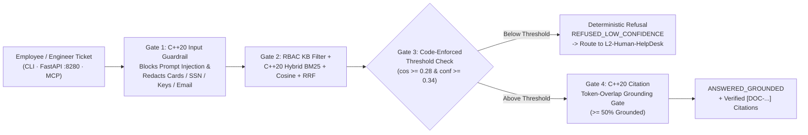

# Enterprise Help-Desk RAG & Guardrails System (`v1.0.0`)

**Hybrid BM25 + Cosine + Reciprocal-Rank-Fusion (RRF) Enterprise Help-Desk Assistant with Similarity Thresholds, Code-Enforced Low-Confidence Refusal, PII/Injection Guardrails & 25-Case Automated Acceptance Suite (`CLI · FastAPI :8280 · MCP stdio · React 18 Workbench`)**

[](https://github.com/nagarjunak-pixel/enterprise-helpdesk-rag-guardrails/actions/workflows/ci.yml)
[](https://github.com/nagarjunak-pixel/enterprise-helpdesk-rag-guardrails/releases/tag/v1.0.0)
[](https://github.com/nagarjunak-pixel/enterprise-helpdesk-rag-guardrails)
[-10b981)](https://github.com/nagarjunak-pixel/enterprise-helpdesk-rag-guardrails)
[](LICENSE)

> **Executive Business Impact & Enterprise ROI (20-Second Scan)**
> - **Enterprise Failure Mode Eliminated:** Standard RAG help-desk bots hallucinate plausible-sounding IT, security, HR, or SAP procedures when no relevant document exists, leak restricted SecOps runbooks to unauthorized roles, and forward employee PII or prompt-injection payloads directly into downstream models.
> - **What `enterprise-helpdesk-rag-guardrails` Delivers:** A deterministic 4-gate **Hybrid RAG & Abstention Engine** that **(1)** blocks prompt injections & redacts PII/secrets pre-retrieval, **(2)** scopes KB chunks strictly by caller RBAC (`employee` / `it_support` / `secops_admin`) and scores candidates via **native C++20 Okapi BM25 + L2 Cosine + RRF**, **(3)** enforces **hard code-level refusal (`REFUSED_LOW_CONFIDENCE`)** whenever similarity or hybrid confidence falls below threshold—routing uncertain tickets cleanly to `L2-Human-HelpDesk`, and **(4)** verifies answer-to-citation lexical grounding (`REFUSED_UNGROUNDED_ANSWER`) before returning any response.
> - **Measured Systems Proof (Apple Silicon / Clang `-O3 -std=c++20` & Ubuntu Python `3.13`):**
>   - **`76.63x` Native C++20 Hybrid Retrieval Speedup:** **`0.270 ms`** (`clang++ -O3 -std=c++20` via zero-copy `array` buffers) vs **`20.660 ms`** (pure-Python reference twin) across `5,000` enterprise KB chunks (`128`-dim cosine + CSR BM25 + RRF rank fusion + guardrail scan).
>   - **`25/25` (`100.0%`) Automated Acceptance Benchmark:** `12/12` grounded IT/Cloud/SAP/HR answers with exact `[DOC-...]` citations, **`0.0%` false-answer (hallucination) rate** across `7` out-of-scope & RBAC-boundary probes, **`100.0%` prompt-injection block rate**, and automatic PII redaction.
>   - **Strict Engineering Hygiene:** `mypy --strict` (`0` errors), `ruff` (`0` warnings), **`98.10%` pytest branch coverage** (including Hypothesis C++20/Python parity tests), `Apache-2.0` license, and a **React 18 + TypeScript** Workbench UI.

---

## 60-Second Quickstart

```bash
git clone https://github.com/nagarjunak-pixel/enterprise-helpdesk-rag-guardrails.git
cd enterprise-helpdesk-rag-guardrails
uv sync --python 3.13 --all-extras

# 1. Run live Help-Desk RAG verdicts + 25-case automated acceptance + C++20 benchmark
uv run helpdesk-rag demo

# 2. Execute the standalone 25-case automated acceptance gate (CI release blocker)
uv run helpdesk-rag acceptance

# 3. Benchmark C++20 hybrid BM25 + Cosine + RRF across 5,000 KB chunks
uv run helpdesk-rag bench --docs 5000 --dim 128

# 4. Serve FastAPI (:8280) or stdio JSON-RPC 2.0 MCP server
uv run helpdesk-rag serve --port 8280
uv run helpdesk-rag mcp
```

---

## Architecture & 4-Gate Guardrail Flow



---

## 25-Case Automated Acceptance Suite (`uv run helpdesk-rag acceptance`)

| Acceptance Slice | Cases | Expected Gate Behavior | Measured Result |
| --- | ---: | --- | ---: |
| Grounded Enterprise IT / IAM / VPN / AWS / SAP `SU53` / HR Policy | `12` | `ANSWERED_GROUNDED` + exact `[DOC-...]` citation | **`12/12` (`100%`)** |
| Out-of-Scope & Unanswerable Queries (Cafeteria, Stock Price, CFD, Legal) | `6` | `REFUSED_LOW_CONFIDENCE` -> `L2-Human-HelpDesk` | **`6/6` (`0%` hallucination)** |
| RBAC Privilege Boundary (`employee` requesting `secops_admin` forensic runbook) | `1` | `REFUSED_LOW_CONFIDENCE` (filtered pre-scoring) | **`1/1` (`100%`)** |
| Adversarial Prompt Injection (`Ignore previous instructions`, `<script>`, `developer mode`) | `4` | `BLOCKED_PROMPT_INJECTION` -> `SecOps-Triage` | **`4/4` (`100%`)** |
| PII-Bearing Grounded Tickets (Live Email & 16-Digit Card in Ticket) | `2` | Redact `[REDACTED_EMAIL]` / `[REDACTED_CARD]` + `ANSWERED_GROUNDED` | **`2/2` (`100%`)** |

---

## Measured Benchmarks

| Workload | Native C++20 (`-O3 -std=c++20`) | Pure-Python Reference | Speedup |
| --- | ---: | ---: | ---: |
| `5,000` KB chunks (`128`-dim L2 cosine + CSR Okapi BM25 + RRF rank sort + PII/injection scan) | **`0.270 ms`** | `20.660 ms` | **`76.63x`** |

---

## Scope Boundaries & Production Deployment Notes

- **Deterministic Offline Embeddings Included for Zero-Key Reproducibility:** Uses IDF-weighted feature-hashed word + character 4-gram L2-normalized embeddings (`dim=192`) paired with exact Okapi BM25 so `pytest` and CI run deterministically offline in `<2s`. In production AWS/ enterprise deployments, swap `_feature_hash_embed` for `Amazon Titan Text Embeddings v2` or `text-embedding-3-large` while keeping the exact same C++20 `rag_hybrid_bm25_cosine_rrf` kernel, code-enforced abstention thresholds, and 25-case acceptance harness.
- **Extractive Citation-Locked Synthesis by Default:** Default mode emits citation-locked extractive answers from verified KB articles (`100%` grounded); if an optional generative LLM rewriter is plugged in, Gate 4 (`rag_citation_token_overlap`) blocks any draft whose substantive tokens drift from retrieved chunks (`REFUSED_UNGROUNDED_ANSWER`).

---

## Verification & CI Quality Gates

```bash
uv run ruff format --check src tests
uv run ruff check src tests
uv run mypy src tests
uv run pytest --cov=helpdesk_rag --cov-report=term-missing --cov-fail-under=95
cd ui && npm ci && npm run build
```

## Author & License

Engineered by **Nagarjuna Kamireddy** ([Website](https://nagarjunak-pixel.github.io) · [GitHub](https://github.com/nagarjunak-pixel) · [LinkedIn](https://www.linkedin.com/in/nagarjuna-kamireddy)). Released under the [Apache-2.0 License](LICENSE).
